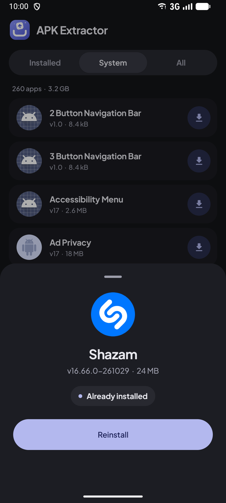

# APK Extractor for Android

Extract, back up, share and install Android apps. Save any installed app as an APK, keep split apps as `.apks` bundles, and install `.apk`, `.apks`, `.xapk` and `.apkm` files with the built-in installer. Free and open source, with no ads and no internet permission.

  
  &nbsp;
  
  &nbsp;
  

  
  &nbsp;
  

## Features

- **Extract any app.** Save installed and system apps as APK files, one at a time or many at once.
- **APK or APKS for split apps.** Most Play Store apps come as split APKs. Merge them into one APK, or keep the original parts as an `.apks` bundle. Choose per app, or set a default.
- **Built-in installer.** Install `.apk`, `.apks`, `.xapk` and `.apkm` files from the Install tab, or share or open them with the app from any file manager. Split bundles install in one go.
- **History.** Every extraction is kept, so you can open its folder, share it or reinstall it later.
- **Search, sort and filter** by app name, package, size, install date or last update.
- Light and dark themes, pure black, and nine accent colours or your own.
- Saves to `Download/APK Extractor` or any folder you choose. About 1.5 MB.

## APK or APKS?

| Save as | What you get | Install with |
|---|---|---|
| **APK** | All parts merged into one APK, re-signed on your device | Any phone, like a normal APK |
| **APKS** | The original parts with their original signature | APK Extractor's Install tab, or any split installer |

A merged APK has a new signature, so uninstall the original app before installing it, and it won't receive Play Store updates. Some apps may not open after being merged; save those as APKS instead.

## Download

Get the latest APK from [Releases](../../releases). Requires Android 7.0 or newer.

## Building

Open the project in Android Studio, or run `./gradlew assembleDebug`.

Development happens on `main`. Every push to `production` is tested and built by GitHub Actions. When `versionName` in `app/build.gradle.kts` is new, a signed APK is published as a GitHub release. See [`.github/workflows/release.yml`](.github/workflows/release.yml).
