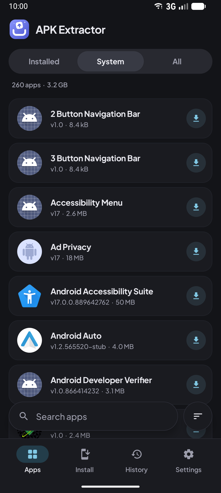
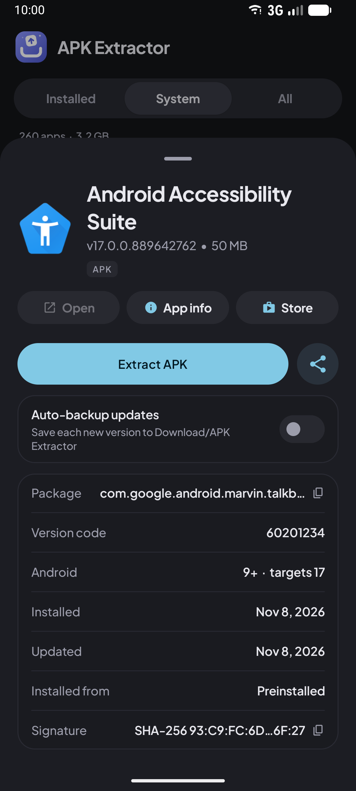
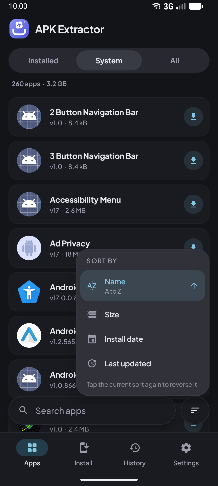
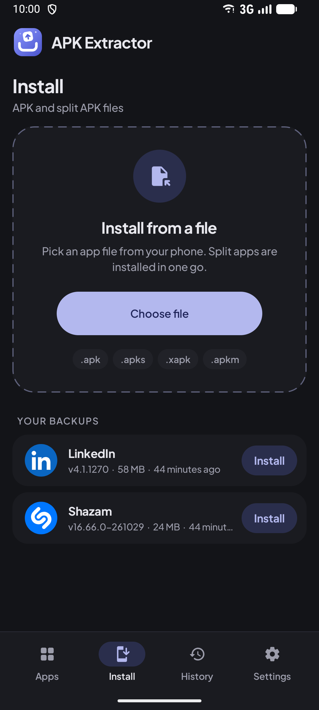
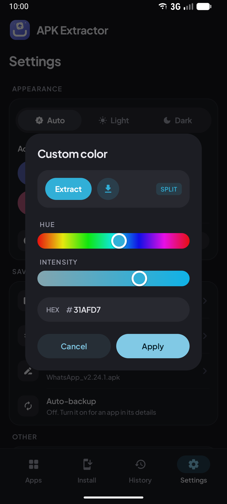
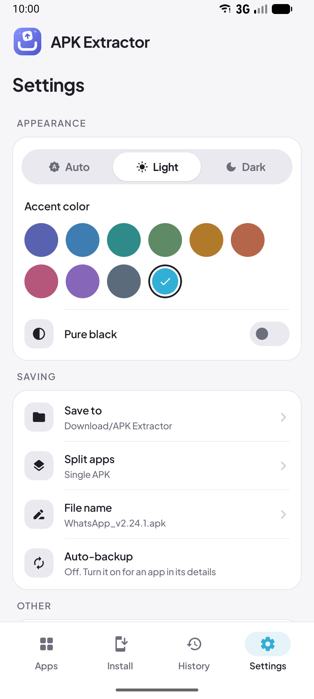

# APK Extractor for Android

Extract, back up, share and install Android apps. Save any installed app as an APK, keep split apps as `.apks` bundles, back apps up automatically when they update, and install `.apk`, `.apks`, `.xapk` and `.apkm` files with the built-in installer. Free and open source, with no ads and no internet permission.

  
  &nbsp;
  
  &nbsp;
  

  
  &nbsp;
  
  &nbsp;
  

## Features

**Extract and share**
- Save installed and system apps as APK files, one at a time or many at once.
- Split apps (most Play Store apps) can be merged into one APK or kept as an `.apks` bundle. Choose per app, or set a default.
- Swipe an app to the right to share it. The file is prepared in the background and the share sheet opens when it's ready.

**Back up automatically**
- Turn on auto-backup for an app and every new version is saved when it updates, even while APK Extractor is closed.
- History groups saved files by app and keeps older versions, so you can share or reinstall a previous version at any time.
- Saving the same version twice replaces the old copy instead of piling up duplicates. Removing an item can be undone.

**Install**
- Install `.apk`, `.apks`, `.xapk` and `.apkm` files from the Install tab, or open or share them with the app from any file manager. Split bundles install in one go.
- Warns before installing over an app signed with a different key, or a newer version.

**Find and inspect**
- Search by name or package (matches are highlighted), filter installed or system apps, and sort by name, size, install date or last update.
- A fast scroller for long lists, with a letter or date bubble while you drag.
- App details show the version code, supported Android versions, install source and signing certificate (SHA-256).

**Make it yours**
- Light, dark and pure black themes, nine accent colours or any colour from the built-in picker.
- Saves to `Download/APK Extractor` or any folder you choose.
- Long-press the app icon for shortcuts: **Install APK** and **Back up apps**.

Small (about 1.7 MB) and quick to open: the app list is cached between launches and the code is precompiled with a Baseline Profile.

## APK or APKS?

| Save as | What you get | Install with |
|---|---|---|
| **APK** | All parts merged into one APK, re-signed on your device | Any phone, like a normal APK |
| **APKS** | The original parts with their original signature | APK Extractor's Install tab, or any split installer |

A merged APK has a new signature, so uninstall the original app before installing it, and it won't receive Play Store updates. Some apps may not open after being merged; save those as APKS instead.

## Download

Get the latest APK from [Releases](../../releases). Requires Android 7.0 or newer.

## Building

Open the project in Android Studio, or run `./gradlew assembleDebug`.

Development happens on `main`. Every push to `production` is tested and built by GitHub Actions. When `versionName` in `app/build.gradle.kts` is new, a signed APK is published as a GitHub release. See [`.github/workflows/release.yml`](.github/workflows/release.yml).
